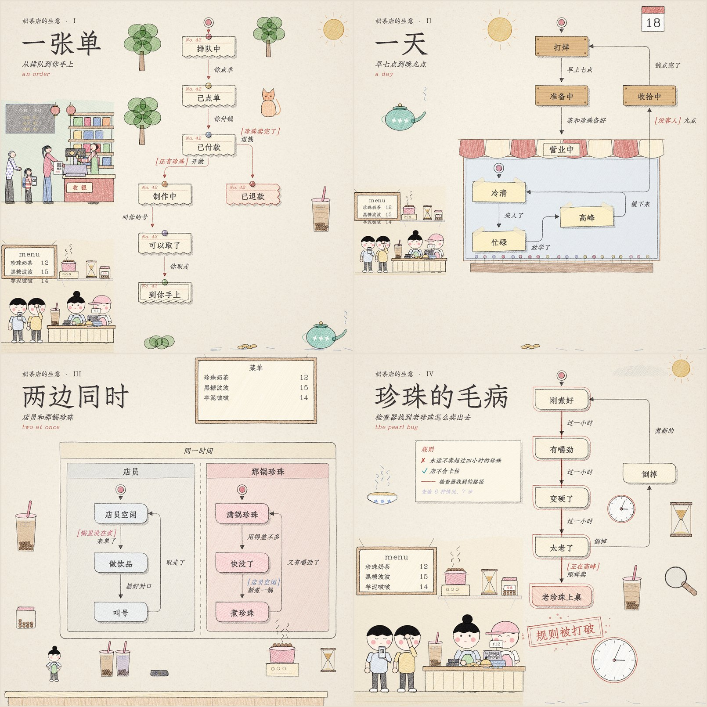
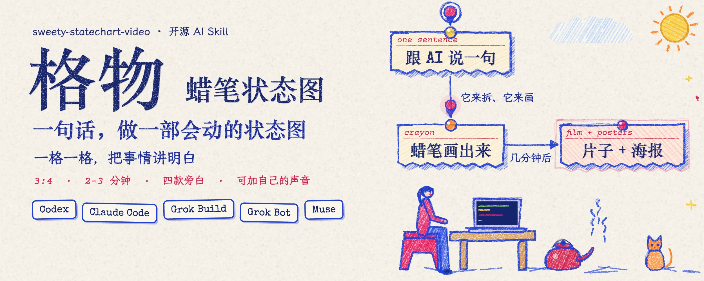

# 格物 · 蜡笔状态图（sweety-statechart-video）

**一格一格，把事情讲明白。**

跟你的 AI 助手说一句话，就能把一个流程、一门生意或一个系统，做成**会动的蜡笔状态图短片**：

- 默认 3:4、2–3 分钟，比例和时长都可以指定；
- 带旁白；
- 默认把封面合成进视频：先显示 0.5 秒，再渐隐 0.5 秒，然后开始正片；声音和字幕一起后移 1 秒（`"cover_intro": false` 可关）；
- 每章还出一张可以直接发的海报；
- 还能出分章短片、长图、动图、可交互网页和作品集页。

灵感来自 Ann Nguyen 老师（[@ann_nnng](https://x.com/ann_nnng/status/2116811409921372642)），我们做了风格提取，再加上：

1. **主流 AI 助手里都能用**：Codex、Claude Code、Grok Build、Grok Bot、Muse。针对各平台做了兼容性调整，效果可能略有差异。后续计划支持 WorkBuddy 等。
2. **四款逼真旁白**：纯合成音色，没有版权问题。也可以加自己的声音：`scv.py add-voice`。
3. **默认 3:4**：任何比例都可以，写 `"aspect": "9:16"` 之类。
4. **时长默认 2–3 分钟**：适配大部分自媒体。想要别的时长，写 `"duration": "1分钟"` 之类。

### v2 新增

- **吸收 Kevin Ngo 的 [statechart-art](https://github.com/kevintngo/statechart-art)**（MIT）：
  - 一章可以写几条规则，海报上的图例标出 ✓ 成立、✗ 打破，以及查了多少种情况；
  - 每条打破的规则各画一条红线；还能“先破后立”：补一道条件，红线淡去，盖一枚绿章；
  - 八种卡片画法：票据、便签、木牌、圆角卡、铜牌、吊牌、玻璃片、毛毡补丁；父状态可以画成店面；箭头可以是红线或金线；等另一条线的条件，用那条线的颜色写；
  - “钢笔彩铅”主题；
  - 聚光、显微镜小窗、跟着音乐卡点，以及作品集页。


- **九种主题**：蓝蜡笔（默认）、钢笔彩铅、夜读、牛皮纸、孔版、亚麻刺绣、四季，也可以由品牌色生成。
- **代码进，片子出**：XState、Mermaid、SCXML、PlantUML，或 /statechart 技能的输出，都能 `import` 成片子的骨架；片子里的图也能 `export` 回去。
- **动起来更像手做**：
  - 图钉落下、卡片晃动，粉圈像蜡笔一样画出来；
  - 盖章时画面一震、溅出墨点，章标题一个字一个字打出来；
  - 镜头可以推近；可以用一个问题开场，片尾扫一遍全部海报。
- **插画更满**：9 个场景件，人物有多种体型和表情，道具超过 130 件；`draft` 自动起草插画，`lint` 逐条报出问题和改法。
- **声音**：
  - 每步可以调语气；
  - 有音效和环境声；
  - 读过的字幕变深；
  - 角色跟着旁白张嘴；
  - 可以出英文版。
- **交付**：
  - 上传母版；
  - 分章短片、长图、各平台尺寸的配图、动图、可交互网页（可以逐步看）、作品集页、发布包；
  - 所有文件都带 GB 45438 的 AI 生成标识。



<p>
   
</p>

做法照着 Ann Nguyen 的 *the making of nhang*（一页往下长的蜡笔状态图），画法和播放器是我们自己写的：

- **一章一张海报，首尾相接。** 奶油色票据卡片带图钉和红色小标签，箭头上写着发生了什么，条件是红色的 `[……]`，四周是彩色蜡笔插画。
- **每一步：**
  - 小圆点带着光晕沿箭头跑，线跟着长出来，字一个个打出来；
  - 新卡片弹出来，变粉，套上粉圈；
  - 页面自动滚动，跟着正在发生的那一步。
- **一直在动：**
  - 所有线条每秒重画 5 次，像手绘动画一样抖；
  - 插画跟着状态动：火苗跳，锅颠勺，蒸汽升，车轮转，电梯跳楼层，门打开，下雨，猫甩尾巴。
- **旁白**：四个专属声音，都是 VoxCPM2 只凭文字描述设计出来的：蜡笔姐姐、图纸哥、元气少女、老师傅。一部片里可以按步骤换声音。
- **规则章**：写一条“这件事不能发生”，内置检查器会找出让它发生的最短路径，画成红线，再盖一个章。


## 用法

Skill 在 `skills/sweety-statechart-video/`，先读它的 `SKILL.md`。一部片子只需要两份文件：

- `film.json`：章节、状态、箭头，以及每一步的字幕（字幕同时是旁白）；
- `scenes.js`：每章的插画，用 130 多个会动的道具、9 个场景件和可以摆姿势的人物拼。

版面全自动排。

```bash
cd skills/sweety-statechart-video
python3 scripts/scv.py new     JOB --title 片名   # 起骨架
python3 scripts/scv.py import  状态机文件 JOB      # 或者从 XState / Mermaid / SCXML / PlantUML / /statechart 输出起骨架
python3 scripts/scv.py check   JOB                # 结构、步骤、字幕，规则章找红线、验证修复
python3 scripts/scv.py layout  JOB                # 成品海报 + 网格 + 空地
python3 scripts/scv.py draft   JOB                # 按空地起草插画
python3 scripts/scv.py lint    JOB                # 插画的问题和改法
python3 scripts/scv.py preview JOB                # 浏览器里带声音预览，改了自动刷新
python3 scripts/scv.py all     JOB                # 配音、排时间、渲染、海报、成片、交付、发布包
python3 scripts/scv.py batch   JOB1 JOB2 JOB3     # 批量
python3 scripts/scv.py gallery                    # 道具和场景件图鉴
python3 scripts/scv.py voices                     # 列出声音
```

例子：

- `examples/intro/`：《一句话，做一部会动的状态图》，5 章，2 分 10 秒，四个声音轮流出场；
- `examples/takeout/`：《一份外卖的一生》，4 章，1.5 分钟，蜡笔姐姐；
- `examples/message/`：《一条消息的旅程》，3 章，1 分钟，图纸哥；
- `examples/boba/`：《一杯奶茶》，4 章，1 分钟，钢笔彩铅主题、方形，四章分别用票据串红线、店面便签、按线着色的两条线、规则图例，对照 statechart-art 的四张海报。

速度：在 M 系列 Mac 上，93 秒的片子渲染约 40 秒，36 句旁白约 3 分钟。

## 环境

- **一键准备**：`bash skills/sweety-statechart-video/scripts/setup.sh`。它建渲染环境，没有 Chrome 时装 Playwright 的 Chromium，最后跑一遍冒烟测试。
- **渲染**：Python 3.9+，Playwright（有 Google Chrome 就用它，没有就用 Chromium），Pillow，ffmpeg。
  - Python 解释器由 `SCV_PYTHON` 指定，默认用 setup.sh 建的 `~/.local/share/sweety-statechart-video/venv`。
  - `python3 scripts/smoke_test.py` 约 16 秒，不需要配音环境。
- **旁白**（Apple Silicon，全部离线）：
  - 一个装有 mlx-audio 0.5.8 和 mlx_whisper 的 Python，由 `STATECHART_MLX_PYTHON` 指定；
  - VoxCPM2-8bit MLX 模型，默认 `~/.local/share/voxcpm2-mlx/models/VoxCPM2-8bit`，可用 `STATECHART_VOXCPM_MODEL` 指定；
  - Whisper large-v3-turbo MLX 模型，放在 HF 缓存里；
  - `scripts/audio_doctor.py` 检查以上各项。
- **没有配音环境时**，在 `film.json` 里写 `"voice": "none"`，做无声版。节奏和参考视频一样，每步 1.2 秒。

## 致谢

- Ann Nguyen 的 *the making of nhang*：效果和节奏的标准；
- Kevin Ngo 的 [statechart-art](https://github.com/kevintngo/statechart-art)（*The business of boba*、*One becomes two*、*Catch*）：规则清单和印章、多种卡片画法、按线上色的条件、聚光和显微镜、按音乐卡点、作品集页；`pencil` 主题用了他的 Kevin Serif / Sans 字体（MIT）。吸收情况见 [复盘](docs/statechart-art-review.md)；
- Lauren Tan（poteto）的 /statechart 技能：用检查器找坏路的思路。

许可、字体和声音的来源见 [THIRD_PARTY_NOTICES.md](THIRD_PARTY_NOTICES.md)。合成旁白属于 AI 生成内容，发布时请标注。

MIT License.
