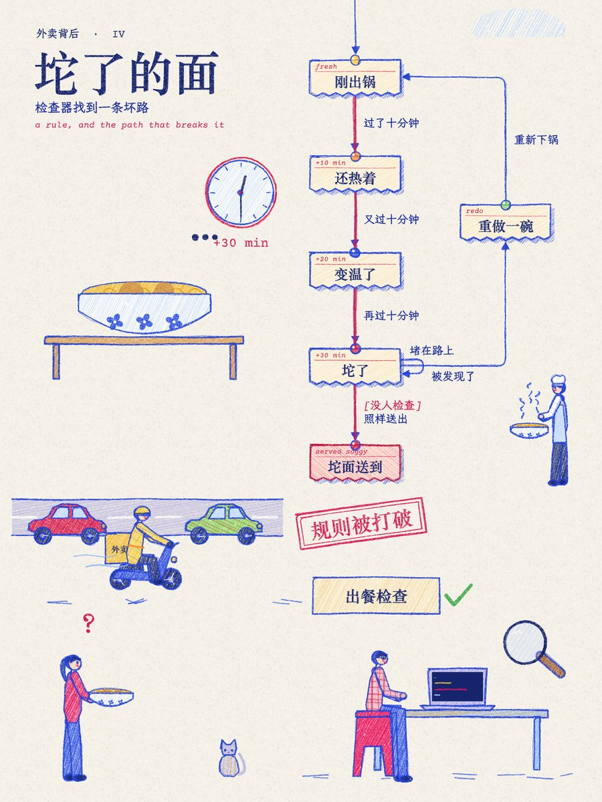

# sweety-statechart-video

把一个流程、一门生意、一个系统，做成**会动的蜡笔状态图短片**：3:4 竖版，带旁白，每章还出一张可以直接发的海报。

<p>
   
</p>

做法照着 Ann Nguyen 的 *the making of nhang*（一页往下长的蜡笔状态图），画法和播放器是我们自己写的：

- **一章一张海报，首尾相接。** 奶油色票据卡片带图钉和红色小标签，箭头上写着发生了什么，条件是红色的 `[……]`，四周是彩色蜡笔插画。
- **每一步：**
  - 小圆点带着光晕沿箭头跑，线跟着长出来，字一个个打出来；
  - 新卡片弹出来，变粉，套上粉圈；
  - 页面自动滚动，跟着正在发生的那一步。
- **一直在动：**
  - 所有线条每秒重画 5 次，像手绘动画一样抖；
  - 插画跟着状态动：火苗跳，锅颠勺，蒸汽升，车轮转，电梯跳楼层，门打开，下雨，猫甩尾巴。
- **旁白**：四个专属声音，都是 VoxCPM2 只凭文字描述设计出来的：蜡笔姐姐、图纸哥、元气少女、老师傅。
- **规则章**：写一条“这件事不能发生”，内置检查器会找出让它发生的最短路径，画成红线，再盖一个章。


## 用法

Skill 在 `skills/sweety-statechart-video/`，先读它的 `SKILL.md`。一部片子只需要两份文件：

- `film.json`：章节、状态、箭头，以及每一步的字幕（字幕同时是旁白）；
- `scenes.js`：每章的插画，用 70 多个会动的道具和可以摆姿势的人物拼。

版面全自动排。

```bash
cd skills/sweety-statechart-video
python3 scripts/scv.py new     JOB --title 片名   # 起骨架
python3 scripts/scv.py check   JOB                # 结构、步骤、字幕，规则章找红线
python3 scripts/scv.py layout  JOB                # 成品海报 + 网格 + 空地，照着写 scenes.js
python3 scripts/scv.py all     JOB                # 配音、排时间、渲染、海报、成片
python3 scripts/scv.py batch   JOB1 JOB2 JOB3     # 批量
python3 scripts/scv.py voices                     # 列出声音
```

例子：

- `examples/takeout/`：《一份外卖的一生》，4 章，蜡笔姐姐；
- `examples/message/`：《一条消息的旅程》，3 章，图纸哥。

速度：在 M 系列 Mac 上，93 秒的片子渲染约 40 秒，36 句旁白约 3 分钟。

## 环境

- **渲染**：Python 3.9+，Playwright（使用本机 Chrome），Pillow，ffmpeg。
  - Python 解释器由 `SCV_PYTHON` 指定，默认 `~/.local/share/sweety-handdraw-video/venv/bin/python`。
  - `python3 scripts/smoke_test.py` 约 16 秒，不需要配音环境。
- **旁白**（Apple Silicon，全部离线）：
  - 一个装有 mlx-audio 0.5.8 和 mlx_whisper 的 Python，由 `STATECHART_MLX_PYTHON` 指定；
  - VoxCPM2-8bit MLX 模型，默认 `~/.local/share/voxcpm2-mlx/models/VoxCPM2-8bit`，可用 `STATECHART_VOXCPM_MODEL` 指定；
  - Whisper large-v3-turbo MLX 模型，放在 HF 缓存里；
  - `scripts/audio_doctor.py` 检查以上各项。
- **没有配音环境时**，在 `film.json` 里写 `"voice": "none"`，做无声版。节奏和参考视频一样，每步 1.2 秒。

## 致谢

- Ann Nguyen 的 *the making of nhang*：效果和节奏的标准；
- Kevin Ngo 的 *The business of boba*：规则章和印章；
- Lauren Tan（poteto）的 /statechart 技能：用检查器找坏路的思路。

许可、字体和声音的来源见 [THIRD_PARTY_NOTICES.md](THIRD_PARTY_NOTICES.md)。合成旁白属于 AI 生成内容，发布时请标注。

MIT License.
