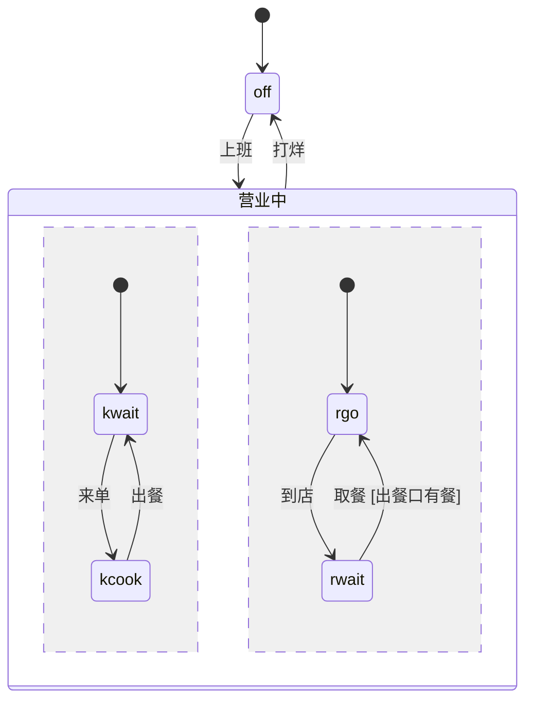

# 导入与导出

仓库里已经有状态机时，不用从头写 `film.json`。`scv.py import` 把它变成一个能跑的骨架：卡片、箭头、条件、父状态、同时发生的几条线，以及走遍每条箭头的步骤。你只需要补字幕、改字、画插画。

```bash
python3 <本 Skill 目录>/scripts/scv.py import 来源文件 JOB [--format xstate|mermaid|scxml|plantuml] [--title 片名] [--force]
python3 <本 Skill 目录>/scripts/scv.py export JOB --to mermaid|xstate|scxml [-o 文件]
```

- 格式按文件名和内容判断，判断不了再写 `--format`。
- JOB 里已有 `film.json` 时不覆盖，要覆盖加 `--force`。
- 导入后 JOB 里有 `film.json` 和一份 `scenes.js` 骨架，和 `scv.py new` 一样。

## 导入以后做什么

1. **改字。** 导入时保留源码里的名字（`waitingForPayment`、`PAYMENT_RECEIVED`），并逐条提醒：
   - 卡片超过 6 个字；
   - 箭头超过 8 个字；
   - 章标题超过 8 个字。

   按硬规则改成看得见的样子和发生的事：卡片写“等付款”，箭头写“你付了钱”。`tag` 里留着源码的 id，可以不动。
2. **写字幕。** 每一步的 `note` 都是 `TODO`，换成一句 24 字以内的话。
   - 步骤顺序已经排好：先走主线到底，再讲岔路；
   - 可以删、合并，也可以加几步纯讲述的。
3. **补 `sub`、`tagline`。**
4. **跑检查：**
   - `scv.py check JOB`：结构和规则；
   - `scv.py layout JOB`：看海报。

   然后照常写 `scenes.js`。

## 怎么换算

| 源码里 | film.json 里 |
|---|---|
| 状态 | 卡片：`label` 是名字，`tag` 是 id |
| 事件 | 箭头的 `label` |
| 守卫 | `if`（照抄文字）；能读成表达式的同时写进 `when` |
| 赋值（XState `assign`、SCXML `<assign>`） | 箭头的 `do`，变量初始值进 `vars` |
| 初始状态 | `start` |
| 终态 | 指向 `end` 的箭头 |
| 只有一层子状态的父状态 | 只有一条线的 `regions`（父状态框） |
| 并行状态 | `regions` 的几条线 |
| 历史状态 | `regions.history: true` |
| 更深的嵌套，或卡片太多、图太高 | 拆成几章：用 `exit` 接 `"go": "entry"`，那一章展开这个状态 |
| `after` 定时、`invoke` 的完成和出错 | 箭头加 `style: "timer"` / `"async"` |

几条规矩：

- **拆章：**
  - 一章最多约 8 张卡片，图的高度要放得进海报；
  - 卡片太多时，从前一章通往后一章的那张卡片，在后一章再画一次，作为起点；
  - 同时发生的线太多时，每条线一章。
- **离开本章：** 箭头指向别的章里的状态时，画成指向终点圆，出口那条除外。
- **跨线的箭头：** 两条线之间的箭头不画，会提醒你改成条件（参考 `[出餐口有餐]`）。
- **整台机器上的事件**（任何状态下都能发生）：每张卡片各画一条箭头，会提醒你只留要紧的。
- **卡片样式：** 名字像出错（error、fail、失败）的卡片标成红钉、`kind: "error"`；像等待的标 `kind: "wait"`。

## XState v5

`.json` 配置直接读。`.js` / `.ts` 文件里找 `createMachine({...})` 或 `setup({...}).createMachine({...})`。

- **有 node 时：**
  - 在 node 的 vm 里跑这个文件。上下文是空的：没有 `require`、`process`，不能 eval，2 秒超时；
  - TypeScript 先去掉类型（node 22.13 以上）；
  - 文件里的常量、`setup` 里的 guards 和 actions 都能用上。
- **没有 node 时：** 用一个宽松的读法只取对象字面量，函数会读成文字。

```ts
// upload.machine.ts
const MAX = 3;
export const uploadMachine = setup({
  guards: { canRetry: ({ context }) => context.retries < MAX },
  actions: { bump: assign({ retries: ({ context }) => context.retries + 1 }) },
}).createMachine({
  id: 'upload', initial: 'idle', context: { retries: 0, done: false },
  states: {
    idle: { on: { PICK: 'sending' } },
    sending: { invoke: { src: 'send', onDone: 'sent', onError: 'failed' }, on: { CANCEL: 'idle' } },
    failed: { always: [{ guard: 'canRetry', target: 'sending', actions: 'bump' }, ...] },
    sent: { type: 'final' },
  },
});
```

```bash
scv.py import upload.machine.ts jobs/upload
```

得到（节选）：

```json
"vars": {"retries": 0, "done": false},
"edges": [
 {"from": "sending", "to": "end", "label": "onDone", "style": "async"},
 {"from": "failed", "to": "sending", "label": "always", "if": "canRetry", "when": "retries < 3", "do": {"retries": "retries + 1"}}
]
```

守卫函数只有一行表达式时，会变成 `when`，`context.` 去掉、常量代入。其余的留作文字。

## Mermaid

读 `stateDiagram` 和 `stateDiagram-v2`，`.md` 文件里取第一段 `stateDiagram`。

- 读：
  - `[*]`、`A --> B : 事件 [条件]`、`state "名字" as id`；
  - `state X { ... }` 和其中的 `--`（同时发生）。
- 不读：`note`、`classDef`、样式。



`scv.py import shift.mmd jobs/shift` 得到一章：`off` 是起点，“营业中”是一个两条线的框，`[出餐口有餐]` 是红字条件。`[stock > 0]` 这类能读成表达式的条件同时写进 `when`；`stock` 不在 `vars` 里时，检查器只把它当字。

## SCXML

读这些元素：

- `<state>`、`<parallel>`、`<final>`、`<history>`；
- `initial`（属性或子元素）；
- `<transition event cond target>` 和其中的 `<assign>`；
- `<datamodel><data id expr>`。

```xml
<scxml initial="closed" name="door" ...>
  <datamodel><data id="locked" expr="false"/><data id="tries" expr="0"/></datamodel>
  <state id="closed">
    <transition event="force" cond="locked &amp;&amp; tries &lt; 3" target="alarm">
      <assign location="tries" expr="tries + 1"/>
    </transition>
  </state>
  <state id="alarm" initial="beep">
    <history id="alarm_h" type="shallow"/>
    ...
  </state>
  <state id="pause"><transition event="resume" target="alarm_h"/></state>
</scxml>
```

得到：

- `vars: {"locked": false, "tries": 0}`；
- `force` 箭头带 `when: "locked && tries < 3"` 和 `do: {"tries": "tries + 1"}`；
- “alarm”框带 `history: true`，`pause > alarm` 回到离开时的那张卡片。

## PlantUML

读这些写法：

- `@startuml`、`[*] --> A`；
- `A --> B : 事件 [条件]`，以及 `-right->` 这类带方向的箭头；
- `state "名字" as X`、`state X { }`；
- 框里的 `--` 和 `||`（同时发生）；
- `[H]` / `X[H]` 历史。

```text
@startuml
state "待机" as Idle
[*] --> Idle
Idle --> Dialing : 拨号
Dialing --> InCall : 接通 [对方在线]
state "通话中" as InCall {
  [*] --> Talking
  Talking --> Muted : 静音
  ||
  [*] --> ScreenOn
  ScreenOn --> ScreenOff : 贴近耳朵
}
Held --> InCall[H] : 切回
@enduml
```

得到：一个两条线的“通话中”框（`history: true`），`切回` 指向框本身。

## /statechart 的输出（TLC 查过的图）

/statechart 技能用 TLA+ 建模、TLC 检查，输出一个 `chart/` 目录：

- `chart.mmd`：Mermaid 图；
- `report.md`：哪些规则守住了，哪些被打破、最短路径是什么；
- 旁边可能还有一个 `layout.mmd`。

导入时给目录或 `chart.mmd` 都行：

```bash
scv.py import statechart-art/business/bug/chart jobs/bug
```

- **图：**
  - `title` 成为片名；
  - 图例框（Legend）不导入；
  - `class X breaks` 的卡片标成红钉；
  - `direction LR` 变成 `"flow": "right"`。`layout.mmd` 里的方向优先。
- **它的条件写法**会变成对状态的 `when`：
  - `[when The tower is Arms closing]`
  - `[when The booster is one of A, B and The ship is none of C]`
  - `[unless cooking pearls]`
- **报告**变成每章的 `rules`：
  - 被打破的规则写成 `never`：TLC 路径走到的那张卡片。报告里的路径存进 `reported`，并加一步 `{"trace": "规则名"}`；
  - 守住的规则只带 `reported`。NoDeadlock 写成 `"stuck": false`，检查器自己再查一遍；
  - TLC 的总数存进这一章的 `reported = {"by": "TLC", "states": 36, "steps": 90}`。

```json
"rules": [
 {"id": "NeverServeOldPearls", "text": "never serve old pearls", "never": "s5",
  "reported": {"holds": false, "by": "TLC", "steps": 6, "path": ["s0", "s1", "s1", "s2", "s3", "s3", "s5"], "edges": ["s0>s1", "s1>s1", ...]}},
 {"id": "NoDeadlock", "text": "no deadlock", "stuck": false, "reported": {"holds": true, "by": "TLC"}}
]
```

`check` 照 TLC 报告的样子打印：

```text
chapter 1: checked 6 configurations and 8 transitions (TLC: 36 states, 90 steps)
  ✗ NeverServeOldPearls breaks in 4 steps: just boiled > chewy > getting firm > too old > an old cup is served
  ✓ TypeOK holds (as reported by TLC)
  ✓ NoDeadlock holds
```

几点说明：

- 检查器只看图，看不到 TLA+ 里的全部变量，所以组合数比 TLC 少。
- 路径可能短一点：TLC 会数原地停留的那几步。
- 两边结论不一样时，`check` 会提醒。
- `scripts/fixtures/statechart-art/` 里有六张这样的图（MIT 许可，来自 kevintngo/statechart-art），可以照着试。

## 导出

```bash
scv.py export JOB --to mermaid            # 打印 stateDiagram-v2，贴进文档
scv.py export JOB --to xstate -o m.json   # XState v5 配置（JSON）
scv.py export JOB --to scxml -o m.scxml
```

- **章节：**
  - 只有一章时，导出的就是这张图本身；
  - 几章时，每章是一个父状态，`exit` 变成指向下一章的箭头。
- **框和终点：**
  - 只有一条线的框是父状态，几条线是并行状态；
  - `end` 是终态。
- **Mermaid：** 条件写在 `[...]` 里，用 `if` 的字。
- **XState：**
  - 条件写成 `guard`，`if` 和 `when` 不同时写成 `{"type": if, "params": {"when": ...}}`；
  - `do` 写成 `{"type": "assign", "params": ...}`；
  - `vars` 写成 `context`；
  - 卡片名字放在 `meta.label`。
- **SCXML：**
  - `when` 写成 `cond`，`do` 写成 `<assign>`，`vars` 写成 `<datamodel>`；
  - 卡片名字和 `if` 放在 `scv:` 命名空间的属性里，别的工具会忽略它们。
- **再导回来：** 导出的文件可以再 `import` 回来，状态、箭头、条件和赋值都在。
